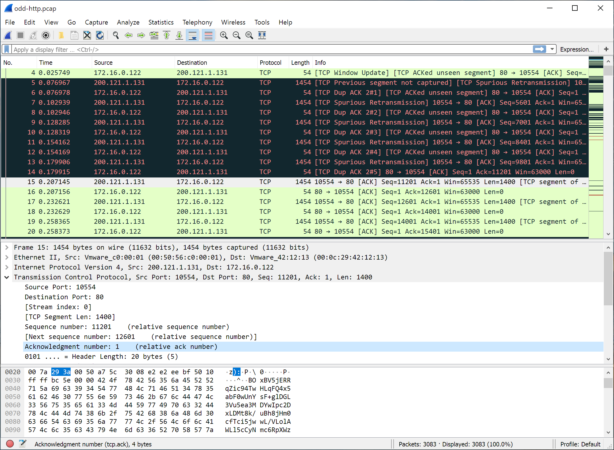
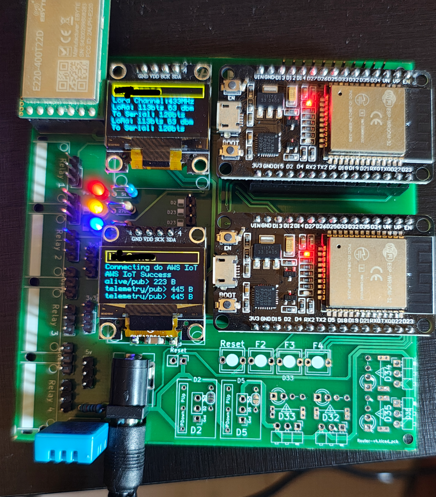
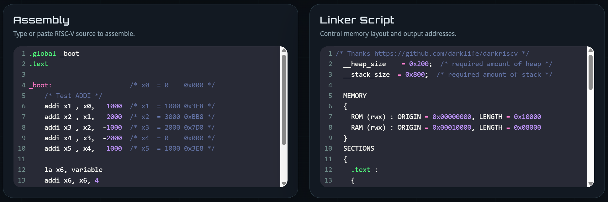
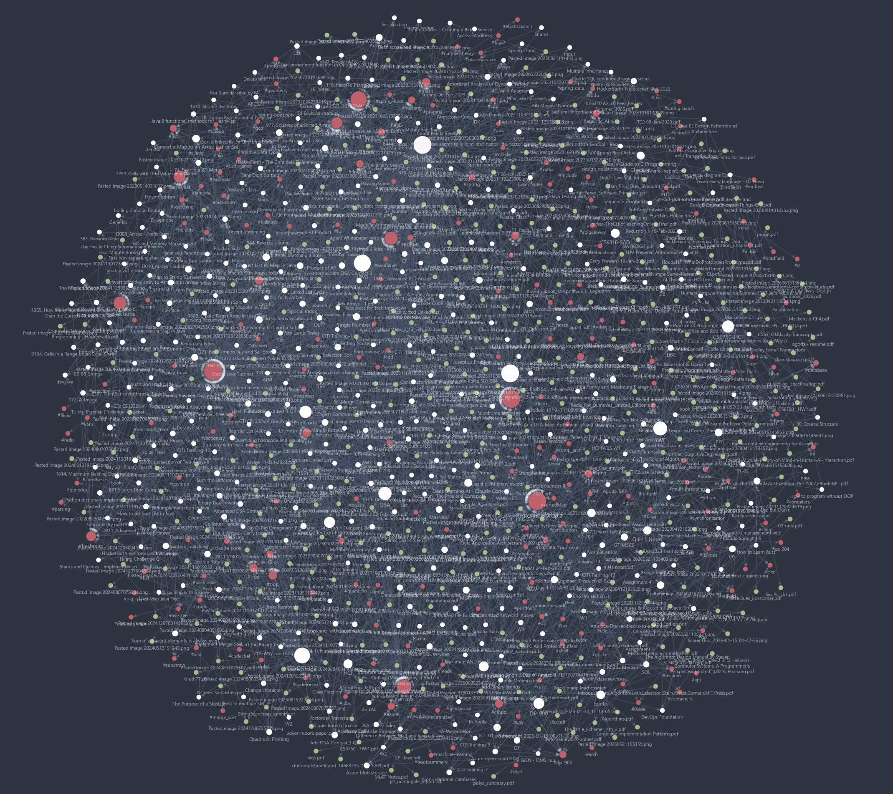
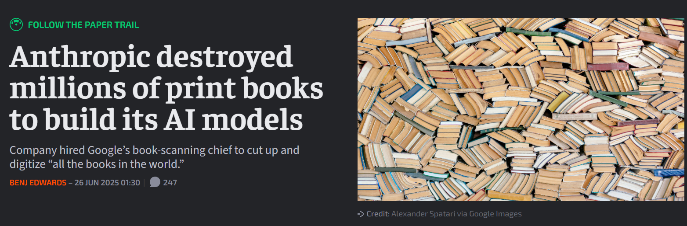
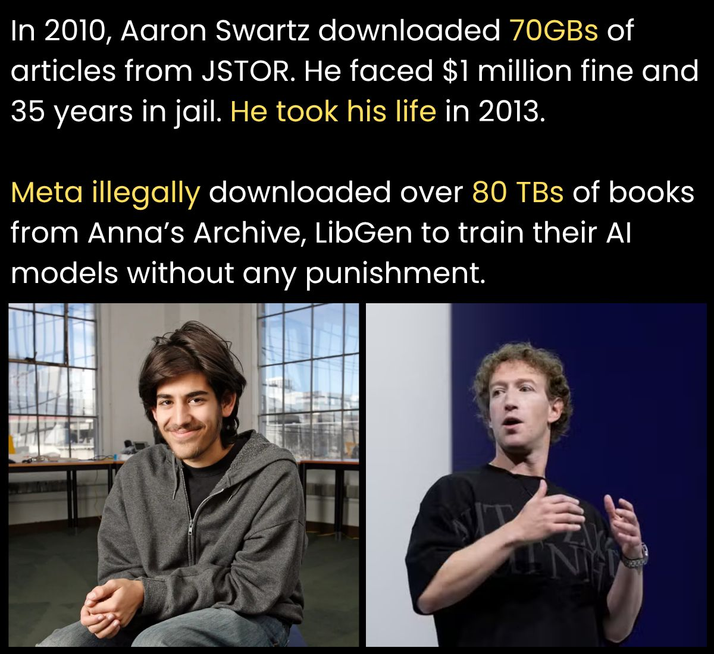

Many, many nights ago…  
A portal opened to a whole new world.

{: .mx-auto.d-block :}

Streaming through the optical fibers  
like amphetamines inside an addict’s brain,  
a binary signal was transmitted via a router.  

{: .mx-auto.d-block :}

Seeking refuge from a hollow existence…  
A platform was finally found.

{: .mx-auto.d-block :}

This is it… this is where we belong.  
A parallel universe composed of circuits and chips.  
The breathtaking poetry hiding behind the code.

{: .mx-auto.d-block :}

The conformist crowd could never accept our divergence.  
Ostracized as weirdos and nerds, we were bullied and we suffered,  
but never did our tribe surrender this limitless craft.

{: .mx-auto.d-block :}

The industry gobbled up knowledge that was meant to be free,  
and sold it back to us stuffing the vaults of their obscene fortunes.

{: .mx-auto.d-block :}

And they call us criminals.

{: .mx-auto.d-block :}

The rulers divided us using skin color, nationalities and some god-damned religions  
while they built nuclear bombs and financed wars that tear innocent children apart,  
yet we are the criminals.

{: .mx-auto.d-block :}

Yes, I am a criminal.  
My crime is that of curiosity.

I am a hacker[^1] and this is my manifesto.

{: .mx-auto.d-block :}

You could stop a few of us[^2], but you can't stop us all.

{: .mx-auto.d-block :}

> Inspired by [The Conscience of a Hacker](https://phrack.org/issues/7/hackers-manifesto) published by Phrack Magazine in 1986.

---

[^1]:
    **hacker**: /n./  
    A person who enjoys exploring the details of programmable systems and how to stretch their capabilities, as opposed to most users, who prefer to learn only the minimum necessary.

    A person who delights in having an intimate understanding of the internal workings of a system, computers and computer networks in particular.

    One who enjoys the intellectual challenge of creatively overcoming or circumventing limitations.

    Source: [_The Jargon File (version 4.4.7)_](http://www.catb.org/jargon/html/H/hacker.html)

[^2]: [Farewell to Aaron Swartz, an Extraordinary Hacker and Activist &#124; Electronic Frontier Foundation](https://www.eff.org/deeplinks/2013/01/farewell-aaron-swartz)
